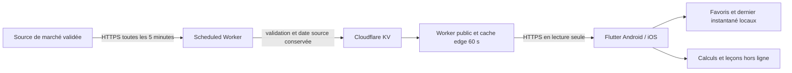

# Architecture et budget

Périmètre validé : Android + iOS, information BRVM, apprentissage et simulation, refonte. Dimensionnement retenu : **1 000 utilisateurs simultanés**, **50 000 FCFA/mois**. La devise n’ayant pas été explicitement donnée, FCFA reste une hypothèse de travail.

## Choix techniques

**Flutter stable et Dart** : code partagé, composants Material 3, typage et rendu mobile. Ce choix ne garantit pas l’absence de bugs ou de failles ; dépendances limitées, verrouillées et à maintenir.

**Pas de compte pour cette version** : aucune donnée de profil distante nécessaire au périmètre. Favoris, progression et scénarios sont des préférences locales non sensibles, dans SharedPreferences. Pas de synchronisation entre appareils ; une désinstallation peut les supprimer. Si l’authentification est ajoutée, stocker ses jetons dans Keychain/Keystore et vérifier les permissions côté serveur.

**Passerelle Worker + KV** : le planificateur collecte toutes les cinq minutes. Les visiteurs ne déclenchent jamais de collecte ; lecture d’un instantané durable, mis en cache par point de présence. Les simulations ne consomment ni serveur ni IA. Actualisation à l’ouverture, à la reprise et sur demande, limitée à une tentative toutes les 30 secondes par instance d’app ; pas de polling continu.

**Défaillances** : timeout mobile 10 secondes, collecte 15 secondes, flux borné à 256 Ko, HTTPS et JSON versionné, redirections refusées. Une collecte invalide conserve le dernier instantané. L’app signale les données de plus de 24 heures ; la passerelle refuse celles de plus de sept jours. Aucun horodatage source n’est remplacé par l’heure du téléchargement. Les exemples sont identifiés.

KV est éventuellement cohérent ; des régions peuvent recevoir des versions légèrement différentes. Adapté à des cours différés pédagogiques, pas à un carnet d’ordres. Ajouter Flutter ne rend pas le serveur existant scalable : il faut corriger les risques de l’audit avant de l’exposer à la charge.

## Enveloppe prévisionnelle

Estimations de planification, pas devis fournisseurs. Vérifier tarifs, change, taxes et conditions de diffusion avant souscription.

| Poste | FCFA/mois | Hypothèse |
|---|---:|---|
| Worker, KV, requêtes | 8 000 | Cache efficace, plan de base et marge |
| Source / service de publication | 15 000 | Réutilisation possible de la source existante |
| Surveillance, journaux, domaine | 7 000 | Rétention courte, alertes simples |
| Réserve | 20 000 | Trafic, incidents, change |
| **Plafond visé** | **50 000** | À mesurer sur trafic réel |

Frais Apple Developer/Google Play et développement hors enveloppe. Une licence de données n’est pas présumée gratuite : si nécessaire et plus chère, revoir le budget. Configurer des alertes de consommation à 50 %, 75 % et 90 % ; une alerte n’est pas un plafond de facturation automatique.

1 000 utilisateurs simultanés ne signifient pas 1 000 requêtes/s. À une actualisation/minute, cela représente environ 17 requêtes/s ; sur 8 h/jour et 30 jours, 14,4 millions de requêtes/mois. Vérifier prix et quotas sur ce volume. L’app actuelle évite cette actualisation permanente.

## Capacité à vérifier

Le test local envoie 1 000 requêtes HTTP parallèles au handler avec un cache edge simulé et préparé. Il vérifie les réponses et l’absence d’appel source ; il ne certifie ni Cloudflare déployé, ni réseau mobile, ni source. Répéter en préproduction autorisée : cache froid/chaud, plusieurs régions, collectes en échec et quotas. Objectifs proposés : erreurs < 1 %, p95 API < 800 ms hors réseau mobile. Résultats réellement mesurés dans `VERIFICATION.md`.

Pour une évolution : Firebase Auth vérifié + App Check + règles par UID pour la synchronisation ; file durable et idempotence pour les alertes ; budget séparé pour l’IA. Aucun de ces services n’est activé implicitement.
